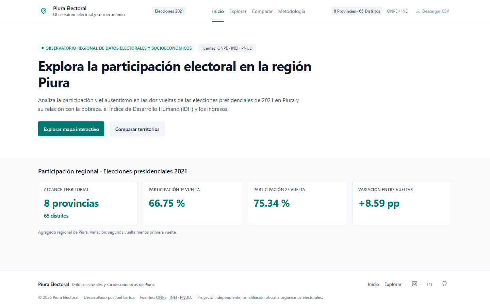
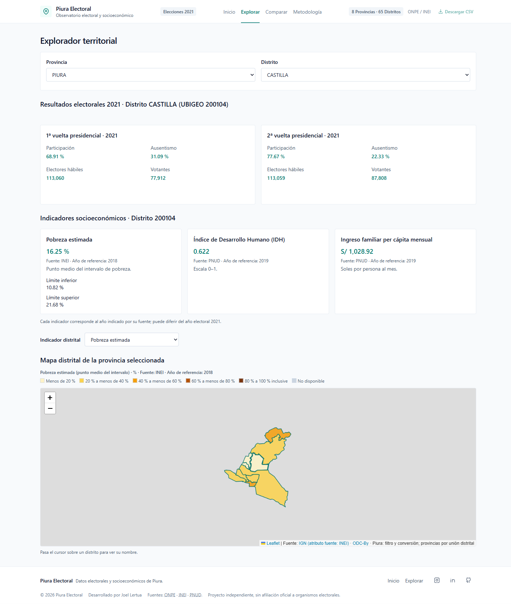
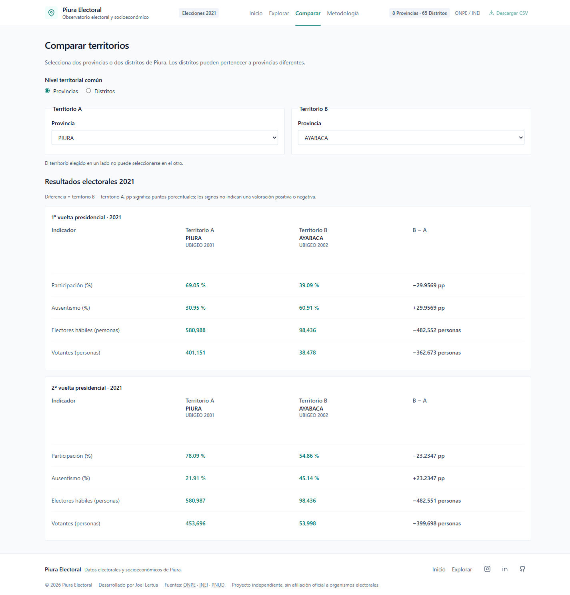

# Piura Electoral

**Datos electorales y contexto socioeconómico para explorar Piura, Perú.**

Aplicación fullstack para consultar mapas, analizar la participación en las elecciones presidenciales de 2021 y comparar territorios de una región con **8 provincias y 65 distritos**.

**[Abrir la aplicación publicada →](https://piuraelectoral.vercel.app/)** · [Repositorio](https://github.com/JoelCoico25/piura-electoral-platform) · [Desarrollo local](docs/desarrollo-local.md)

## La aplicación en imágenes

Capturas auténticas de la versión pública, tomadas el 17 de octubre de 2026 con datos cargados. Las imágenes están optimizadas sin pérdida y conservan los textos y cifras originales.

### Inicio

Participación regional de ambas vueltas, variación y alcance territorial.



<details>
<summary><strong>Explorar: resultados e indicadores del distrito de Castilla</strong></summary>

Selección territorial, ambas vueltas electorales, indicadores con sus años de referencia y mapa distrital de pobreza.



</details>

<details>
<summary><strong>Comparar: provincia de Piura frente a Ayabaca</strong></summary>

Resultados de primera y segunda vuelta con diferencias descriptivas B − A.



</details>

La cartografía mostrada procede del recurso distrital IGN bajo ODC-By, cuyo atributo de fuente indica INEI. Las provincias son derivadas mediante unión distrital. Consulta la [atribución cartográfica](apps/web/public/geo/ATRIBUCION.md).

## Funcionalidades

- **Inicio:** participación regional, variación entre vueltas y cobertura territorial.
- **Explorar:** mapa provincial de participación electoral y mapas distritales de pobreza, IDH e ingreso; selección sincronizada entre polígonos y desplegables.
- **Comparar:** dos provincias o dos distritos, incluso de provincias diferentes. Resultados electorales de ambas vueltas y diferencias B − A; socioeconomía únicamente para distritos con años compatibles.
- **Metodología:** fuentes, fórmulas, reglas de comparación, procesamiento territorial y limitaciones en nueve secciones desplegables.

Interfaz responsive, navegación por teclado, formato numérico `es-PE` y estados de carga, error y datos no disponibles.

## Arquitectura y tecnologías

| Capa | Tecnologías y responsabilidades |
|---|---|
| Frontend | React 19, TypeScript estricto, Vite 8 y Tailwind CSS v4. Organización por funcionalidades y componentes con carpetas individuales. |
| Navegación y datos | React Router con carga diferida y precarga de Explorar; TanStack Query con consultas compartidas por UBIGEO, caché y cancelación. |
| Mapas | React Leaflet y Leaflet; GeoJSON MultiPolygon WGS84 con selección territorial y escalas coropléticas. |
| API | Node.js, Fastify 5, TypeScript y validación de parámetros. Documentación OpenAPI y acceso a PostgreSQL mediante `pg`. |
| Base de datos | PostgreSQL 16; migraciones SQL, restricciones de integridad y carga de CSV procesados. Agregación electoral a partir de conteos distritales. |
| Entorno y publicación | Bun para frontend, npm para API, Docker Compose para PostgreSQL local; frontend publicado en Vercel y API en Render. |

```text
apps/web/             Frontend, recursos públicos y pruebas Bun
apps/api/             API Fastify y pruebas Vitest
database/             Migraciones, importadores y CSV locales excluidos
docs/                 Guía técnica, trazabilidad y capturas
```

## Pruebas automatizadas

- **36 pruebas frontend con Bun:** diferencias B − A, signos, unidades, precisión, valores null, compatibilidad de años y métricas regionales de 2021.
- **7 pruebas backend con Vitest:** niveles UBIGEO, errores de validación y petición, respuestas internas seguras, CORS y metadatos OpenAPI mediante Fastify inject.

Las pruebas actuales utilizan fixtures o sustituciones controladas y no requieren navegador, PostgreSQL ni servicios externos. No hay una suite end-to-end versionada ni se declara un porcentaje de cobertura.

| Dentro de `apps/web` | Dentro de `apps/api` |
|---|---|
| `bun --no-env-file run test` | `npm test` |
| `bun --no-env-file run typecheck` | `npm run typecheck` |
| `bun run lint` | — |
| `bun run build` | `npm run build` |

La [guía de desarrollo local](docs/desarrollo-local.md) contiene requisitos, variables de entorno, instalación, Docker, migraciones, comandos Bash y PowerShell y solución de problemas. La [documentación del frontend](apps/web/README.md) detalla sus módulos y pruebas.

## Fuentes y años de referencia

| Información | Fuente | Referencia |
|---|---|---|
| Elecciones presidenciales, primera y segunda vuelta | ONPE | 2021 |
| Pobreza monetaria distrital e intervalos | INEI | 2018 |
| IDH e ingreso familiar per cápita mensual | PNUD | 2019 |
| Catálogo UBIGEO | Procedencia institucional original pendiente | Archivo identificado como 2022 |
| Cartografía provincial y distrital | IGN; atributo de fuente INEI | Recurso publicado el 24 de junio de 2025, sin fecha acreditada de vigencia territorial |

Los años **no representan una medición simultánea**. Las comparaciones son descriptivas, no causales. El valor central de pobreza es el punto medio de un intervalo, calculado por la plataforma; no una medición puntual independiente publicada por INEI.

## Alcance y limitaciones

- La plataforma se limita a Piura. Los indicadores socioeconómicos se muestran solo a nivel distrital; no se calculan promedios provinciales.
- Las diferencias se calculan con valores originales antes de aplicar formato. Si faltan datos o los años socioeconómicos difieren, no se inventan diferencias.
- Los conjuntos ONPE identificados y la cartografía IGN declaran ODC-By, con obligaciones de atribución. La autorización de redistribución de pobreza, IDH e ingresos y catálogo UBIGEO sigue sin acreditarse.
- Los seis CSV procesados permanecen fuera de Git. Un clon incluye las geometrías autorizadas, pero no los datos necesarios para reconstruir la base completa; tampoco se incluyen todos los originales ni un entorno completo para regenerarlos.

Consulta las [fuentes y su trazabilidad](docs/mapeo_fuentes.md) para conocer publicaciones, transformaciones y condiciones de uso.

## Autor

Desarrollado por **Joel Lertua** · [GitHub](https://github.com/JoelCoico25) · [LinkedIn](https://www.linkedin.com/in/joel-lertua-coico-125ab2218/)

Proyecto independiente, sin afiliación oficial con los organismos citados.
